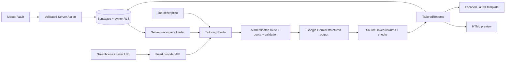

# Forma — AI-Powered ATS Resume Architect

A complete Next.js application with a premium dark interface, an interactive React Three Fiber landing page, a comprehensive Master Vault, and an AI resume studio with HTML preview and downloadable LaTeX.

## Run locally

Requires Node.js 24.x and npm, matching the runtime declared for Vercel.

```sh
cd resume-architect
npm install
cp .env.example .env.local
npm run dev
```

Open **http://127.0.0.1:3000**. Missing or partial Supabase configuration keeps the application in a clearly labeled local demo. A fictional profile is supplied; edit it in the Master Vault, save, then use “Try a sample job” in the studio. Demo tailoring runs in the browser, reorders original achievements and skills, and calculates keyword coverage. It does **not** call or imitate a live AI service. Demo profiles are saved to this browser only. A blocked storage permission is reported by the editor.

The environment template now targets `https://resume-architect-seven.vercel.app`. For local authentication or API testing, set `NEXT_PUBLIC_APP_URL=http://127.0.0.1:3000` in your local environment and restart. Production keeps the HTTPS origin from the template.

The landing page’s role switcher and resume are illustrative. Studio results use the current saved profile and supplied job description. A generated result is held in the current studio view; live generated resumes are also stored in Supabase. A resume-history interface is not included.

## Enable Supabase and Google Gemini

1. Create a Supabase project. Run `supabase/schema.sql` in its SQL editor. The script creates profile/resume tables, ownership policies, and shared request quotas.
2. Create a Gemini API key in [Google AI Studio](https://aistudio.google.com/apikey), then set `.env.local` using `.env.example`:

   ```dotenv
   NEXT_PUBLIC_APP_URL=http://127.0.0.1:3000
   NEXT_PUBLIC_SUPABASE_URL=https://YOUR_PROJECT.supabase.co
   NEXT_PUBLIC_SUPABASE_ANON_KEY=YOUR_PUBLIC_ANON_KEY
   GEMINI_API_KEY=YOUR_SERVER_ONLY_GEMINI_KEY
   GEMINI_MODEL=gemini-3.8-flash
   ```

3. In Supabase Authentication → URL Configuration, set the Site URL to the exact application origin and allow `http://127.0.0.1:3000/auth/callback`. For deployment, use the HTTPS production URL for both settings and `NEXT_PUBLIC_APP_URL`. Do not mix `localhost` and `127.0.0.1`.
4. Enable the email/password provider and email confirmation. Configure production SMTP before inviting users. Supabase handles password storage and authentication rate limits.
5. Restart development after changing environment variables; rebuild production whenever public environment values change. Create an account at `/login`, confirm the email, fill the Master Vault, and generate in `/studio`.

You can set `NEXT_PUBLIC_SUPABASE_PUBLISHABLE_KEY` instead of the legacy `NEXT_PUBLIC_SUPABASE_ANON_KEY`; the publishable key takes precedence when both are set.

`GEMINI_MODEL` is optional and defaults to `gemini-3.8-flash`. The server reads only `GEMINI_API_KEY` for AI authentication; no OpenAI key or account is required. If upgrading an existing setup, replace the old `OPENAI_*` environment variables with these Gemini variables and run `supabase/schema.sql` to ensure the shared quota function is installed.

Gemini free-tier access depends on the model, region, account eligibility, and quotas; usage on a billed project is not guaranteed to be free. Free and paid tiers also differ in how Google uses submitted data. Check [Gemini API pricing and data-use terms](https://ai.google.dev/gemini-api/docs/pricing) for your project before sending a real profile. Live tailoring sends the profile and job description to Google Gemini.

The app does not use a Supabase service-role key. All profile and resume reads/writes use the authenticated user's session and row-level security. A server-side Gemini key alone is insufficient: live generation requires complete Supabase configuration, a verified Supabase user, and the quota migration. Missing or partial Supabase configuration remains in demo mode; with Supabase configured, account pages require a valid authenticated session. No credentials are included in the source or browser bundle.

## Project structure

```text
app/
├── layout.tsx                  # Metadata, shared styling and accessibility
├── page.tsx                    # Landing page
├── dashboard/page.tsx          # Authenticated Master Vault / local demo
├── studio/page.tsx             # Authenticated tailoring studio / local demo
├── login/page.tsx              # Email sign-in and account creation
├── actions/
│   ├── auth.ts                 # Sign in, sign up, sign out Server Actions
│   └── profile.ts              # Validate and persist profile Server Action
├── api/
│   ├── tailor/route.ts         # Validated, authenticated Gemini tailoring
│   └── jobs/extract/route.ts   # Safe job-board imports
├── auth/callback/route.ts       # Supabase PKCE code exchange
├── globals.css                 # Tailwind, design tokens, application shell
├── landing.css                 # Landing page and 3D visual framing
├── profile.css                 # Master Vault and authentication styles
├── studio.css                  # Studio, resume, code preview and print styles
├── error.tsx / not-found.tsx    # Recovery states
└── icon.svg                    # Forma favicon
components/
├── Background3D.tsx            # Pointer-reactive nodes, particles, fallback
├── LandingPage.tsx             # Hero, interactive preview, features, FAQ
├── AppShell.tsx                # Responsive workspace navigation
├── WorkspaceGate.tsx           # Server-side user/profile loading
├── ProfileEditor.tsx           # Add/edit/remove profile collections
├── AuthForm.tsx                # Authentication and configuration states
├── TailorStudio.tsx            # Job input, generation, analysis and exports
├── ResumePreview.tsx           # Semantic, single-column HTML resume
└── LatexEditor.tsx             # Highlighted, selectable source and copy
lib/
├── ai/prompt.ts                # Full system prompt
├── ai/gemini.ts                # Server-only Gemini request and error handling
├── ai/assemble.ts              # Source references, guarded rewrites, output
├── supabase/                   # SSR and browser clients, configuration
├── store.tsx                   # Per-workspace Zustand store + demo storage
├── workspace.ts                # Authorization and profile retrieval
├── schemas.ts                  # Zod profile/request/model validation
├── demo.ts                     # Fictional sample and local demo engine
├── matching.ts                 # Keyword extraction and coverage calculation
├── latex.ts                    # Deterministic template and LaTeX escaping
├── jobs.ts                     # Greenhouse and Lever import adapters
├── http.ts                     # Origin checks, body limits, safe errors
└── api-context.ts              # Verified sessions and shared quota checks
types/index.ts                  # UserProfile, Experience, Education,
                               # Project, Certification, TailoredResume
middleware.ts                   # Supabase session refresh
supabase/schema.sql             # PostgreSQL schema, RLS and quota function
tests/                          # Node test runner / TypeScript regression tests
.env.example                    # Required configuration, no secrets
```

## Data flow and architecture



**Framework:** Next.js 15 App Router, TypeScript, React 19, Tailwind CSS 4. Animation uses Framer Motion; 3D uses React Three Fiber, Drei, and Three.js. The canvas is dynamically loaded, limits rendering resolution, uses seeded particles, respects reduced motion, and has a CSS fallback for unsupported WebGL. No remote font or image requests are necessary.

**State:** a scoped Zustand store supplies saved profile and generated output to the current workspace. The profile editor keeps its unsaved draft separate. Only demo profiles use localStorage; account profiles are retrieved through Supabase on the server. Refreshing or navigating away discards unsaved edits. Account results are persisted before the API returns success.

**AI:** `lib/ai/gemini.ts` calls Google Gemini at `https://generativelanguage.googleapis.com/v1beta/openai/`, using the existing OpenAI SDK strictly as transport through [Google’s compatibility API](https://ai.google.dev/gemini-api/docs/openai). Requests go to Google, authenticated with `GEMINI_API_KEY`; no requests go to OpenAI. The structured JSON schema, Zod validation, and `RESUME_SYSTEM_PROMPT` in `lib/ai/prompt.ts` remain the model contract. The model identifies keywords, prioritizes relevant skills and achievements, proposes source-linked summary/bullet rewrites, and produces a LaTeX draft. Employer names, roles, dates, education, identity and skill inventory are copied from the master profile. Rewrites must cite original sources; the assembler rejects unknown sources, changed numeric facts, and recognized unsupported skill claims. These checks cannot prove semantic fidelity, so generated highlights instruct the user to review the wording. The master profile is never overwritten by a tailored output.

**LaTeX:** the model's draft is not trusted or compiled. `generateLatex(profile)` rebuilds the export from the same validated data rendered by the preview. It uses `article`, `geometry`, `enumitem`, `hyperref`, and `titlesec`, with font/Unicode extraction support. Dynamic backslashes, `&`, `%`, `$`, `#`, `_`, `{`, `}`, `~`, and `^` are escaped. External URLs are restricted to HTTP(S) without credentials. There is no shell execution or server-side compiler endpoint.

**Matching:** scores are the percentage of extracted job keywords detected in the final resume, with case-insensitive boundary matching. They are neither hiring probabilities nor an employer's ATS score. Missing requirements remain visible rather than being invented. Demo keyword extraction is a bounded vocabulary plus the user's skills; live AI can identify additional terms when grounded in the supplied job text. Neither path provides exhaustive semantic evaluation.

## APIs and Server Actions

| Entry point | Input | Result |
|---|---|---|
| `POST /api/tailor` | `{ profile: UserProfile, jobDescription: string }` | `{ resume: TailoredResume }` |
| `POST /api/jobs/extract` | `{ url: string }` | `{ text: string }` |
| `saveProfile(profile)` | Validated profile | `{ ok: boolean, error?: string }` |
| `signIn(formData)` / `signUp(formData)` | Email and password | Redirect on success, or `{ error?, message? }` |
| `signOut()` | Current session | Invalidates the session and redirects |

API errors use `{ error: string }` with appropriate status codes. POST routes require the exact application Origin and JSON content type. Job descriptions must contain 80–24,000 characters; profiles, responses and stream sizes are bounded. The provider request has a timeout and no automatic retries. Live limits are 10 tailoring attempts and 30 imports per account per UTC hour, enforced atomically in PostgreSQL; failed provider attempts also count.

Gemini service errors distinguish missing configuration, invalid API credentials, exhausted provider quota or rate limits, and other provider failures. These failures return an actionable message to the studio; they do not silently substitute demo output. Google’s project quotas apply separately from the app’s per-account limits.

Job import supports direct Greenhouse and Lever posting URLs. It extracts the posting identifier and fetches only a fixed HTTPS provider API; it does not fetch arbitrary user URLs or follow redirects. Unsupported sites, inaccessible postings and expired jobs return an actionable error and preserve manual text entry. This intentionally avoids an unrestricted SSRF-prone scraper.

## Export and compile

Use **Copy LaTeX** or **Export .tex** in the studio. Upload the `.tex` file to Overleaf and choose pdfLaTeX, or use a local TeX distribution:

```sh
pdflatex -no-shell-escape -interaction=nonstopmode alex-morgan.tex
```

The HTML preview shares the content and section order with the export; it is not a TeX rendering and line wrapping/page breaks can differ. Output may span multiple pages for longer careers. Review overflow after compiling. The standard pdfLaTeX setup handles common Latin text; CJK and other unsupported scripts require suitable fonts and a XeLaTeX/LuaLaTeX template adaptation. The app does not claim a generated PDF until an external compiler succeeds.

## Checks and deployment

```sh
npm run typecheck
npm run lint
npm test
npm run build
npm start
```

Tests cover the Gemini endpoint, credentials, model selection, structured response validation and provider error handling using mocked HTTP responses, plus missing/partial Supabase configuration, escaping and injection attempts, URL preservation, keyword boundaries, profile bounds, provider URL allowlists, bounded reads, origin checks, source references, numeric preservation and valid grounded rewrites. The test runner enables the React server condition to load the server-only AI module. Browser checks cover the no-key demo workflow. Supabase account flows, RLS execution and live Gemini requests require your configured environment and are not exercised by the local unit suite.

Deploy to a Node-capable Next.js host such as Vercel or a container/service; static export is not supported because the application uses Server Actions and API routes. Set the production environment, run the schema migration, configure the Supabase redirect allowlist, and build. Keep the runtime timeout at least 60 seconds for AI generation. Set `NEXT_PUBLIC_APP_URL` to the canonical origin. Local verification does not verify the live deployment's environment or authentication settings.

See [DEPLOYMENT.md](./DEPLOYMENT.md) for the Vercel project settings, environment-variable scopes, production validation, and Supabase callback setup. Route-level function timeouts are already configured; no `vercel.json` is needed.

There is no payment integration. The landing feature grid advertises the available local demo and account workflow without fictitious subscription checkout.

## Primary documentation

- [Google Gemini OpenAI compatibility](https://ai.google.dev/gemini-api/docs/openai)
- [Google Gemini API pricing and data-use terms](https://ai.google.dev/gemini-api/docs/pricing)
- [Google AI Studio API keys](https://aistudio.google.com/apikey)
- [Supabase SSR clients](https://supabase.com/docs/guides/auth/server-side/creating-a-client?framework=nextjs)
- [Next.js asynchronous cookies](https://nextjs.org/docs/app/api-reference/functions/cookies)
- [Greenhouse Job Board API](https://docs.greenhouse.io/job-board.html)
- [Lever Postings API](https://github.com/lever/postings-api)
