# Forma — AI-Powered ATS Resume Architect

A complete Next.js application with a premium dark interface, an interactive React Three Fiber landing page, a comprehensive Master Vault, English/Polish UI, and an AI resume studio with live preview, LaTeX source, free watermarked demo PDFs, and paid final PDF downloads.

## Run locally

Requires Node.js 24.x and npm, matching the runtime declared for Vercel.

```sh
cd resume-architect
npm install
cp .env.example .env.local
npm run dev
```

Open **http://127.0.0.1:3000**. The Master Vault and studio are available without an account, starting with a blank CV. Guest edits are automatically preserved in a browser draft, including unfinished fields, studio inputs, selected tabs, and generated previews. Your own CV and LaTeX preview are available without entering a job description.

Guest tailoring runs locally: paste a job description or choose “Try a sample job” to prioritize your original achievements and skills and calculate keyword coverage. It makes no Gemini request. Automatic URL import and server-side Gemini tailoring are available after sign-in. The landing page’s example resume and role switcher are illustrative; they are not prefilled into your guest CV.

**Guest editing and Save draft are free and do not require an account.** Unfinished fields can be saved locally while you complete the CV. **Download demo PDF** is also free and includes a centered diagonal “forma” watermark on every page. The live preview carries the same watermark for an unpaid version. **Download Final CV** and **Remove Watermark** open account access for guests, then Stripe Checkout for signed-in users. Explicit LaTeX copying uses the same unlock flow. Account access never discards the guest draft. Sign-up or sign-in associates that draft with the entered email; only a server-verified account with the same email can claim it. Transferring a draft already linked to a different email requires checking the transfer option. An account without an existing profile automatically imports the draft. If a different profile already exists, it is never automatically overwritten: use **Open guest CV**, review it, then explicitly save to replace the account profile. Failed imports retain the browser draft and offer retry/recovery.

Browser drafts prefer local storage and fall back to session storage, which lasts only for the current tab session. If storage is blocked or full, the app warns you to keep the tab open and enable storage before signing in. Drafts belong to the browser origin, so continue on the same domain and browser. Signed-in profiles and live generated resumes are stored in Supabase; studio state also has an account-scoped session cache. A resume-history interface is not included.

Use the **EN / PL** switch in the header to translate the landing page, builder, studio, account dialogs, and PDF section headings. The preference persists in browser storage and a first-party cookie for subsequent page views. Changing the UI language does not translate or rewrite the user’s CV content.

The environment template targets `https://resume-architect-seven.vercel.app`. For local authentication or API testing, set `NEXT_PUBLIC_APP_URL=http://127.0.0.1:3000` and restart. Local HTTP also supports `http://localhost:3000`; use the same chosen origin in the browser and callback configuration. Production keeps the HTTPS origin from the template.

## Enable Supabase and Google Gemini

1. Create a Supabase project. Run `supabase/schema.sql` in its SQL editor. The script creates profile/resume tables, ownership policies, and shared request quotas.
2. Create a Gemini API key in [Google AI Studio](https://aistudio.google.com/apikey), then set `.env.local` using `.env.example`:

   ```dotenv
   NEXT_PUBLIC_APP_URL=http://127.0.0.1:3000
   NEXT_PUBLIC_SUPABASE_URL=https://YOUR_PROJECT.supabase.co
   NEXT_PUBLIC_SUPABASE_ANON_KEY=YOUR_PUBLIC_ANON_KEY
   GEMINI_API_KEY=YOUR_SERVER_ONLY_GEMINI_KEY
   GEMINI_MODEL=gemini-3.8-flash
   ```

3. In Supabase Authentication → URL Configuration, set the Site URL to your canonical application origin and allow the exact callback, such as `http://127.0.0.1:3000/auth/callback` locally or `https://resume-architect-seven.vercel.app/auth/callback` in production. Match `NEXT_PUBLIC_APP_URL`; do not mix `localhost`, `127.0.0.1`, or deployment aliases. See [Supabase’s Site URL and redirect allowlist documentation](https://supabase.com/docs/guides/auth/redirect-urls).
4. Enable the email/password provider. The hosted Supabase dashboard controls email confirmation; this repository has no `supabase/config.toml`, and no local confirmation setting is changed. With confirmation disabled, signup can return an immediate session and import the draft. With confirmation enabled, open the confirmation link in the same browser and application origin, then sign in if prompted. Both flows verify the authenticated account before importing. Configure production SMTP for email delivery.
5. Restart development after changing environment variables; rebuild production whenever public environment values change. Start building and saving drafts as a guest, then use **Download Final CV**, **Remove Watermark**, the account link, or `/login` to access your account. After sign-in, `/studio` uses server-side Gemini tailoring.

You can set `NEXT_PUBLIC_SUPABASE_PUBLISHABLE_KEY` instead of the legacy `NEXT_PUBLIC_SUPABASE_ANON_KEY`; the publishable key takes precedence when both are set.

`GEMINI_MODEL` is optional and defaults to `gemini-3.8-flash`. The server reads only `GEMINI_API_KEY` for AI authentication; no OpenAI key or account is required. If upgrading an existing setup, replace the old `OPENAI_*` environment variables with these Gemini variables and run `supabase/schema.sql` to ensure the shared quota function is installed.

Gemini free-tier access depends on the model, region, account eligibility, and quotas; usage on a billed project is not guaranteed to be free. Free and paid tiers also differ in how Google uses submitted data. Check [Gemini API pricing and data-use terms](https://ai.google.dev/gemini-api/docs/pricing) for your project before sending a real profile. Live tailoring sends the profile and job description to Google Gemini.

Cloud profile and AI resume reads/writes use the authenticated user's session and row-level security. Only the payment backend uses `SUPABASE_SERVICE_ROLE_KEY`, behind server-only modules, to create immutable purchase snapshots and record verified payment entitlements. This key is never exposed to the browser. A server-side Gemini key alone is insufficient: live generation requires complete Supabase configuration, a verified Supabase user, and the quota migration. Missing or partial Supabase configuration retains the guest builder and local previews, while account access remains unavailable. Configuring Supabase does not force guests to sign in to edit or preview. No secret credentials are included in the source or browser bundle.

## Enable final PDF purchases

Apply `supabase/payment-schema.sql` after the base schema, then add `STRIPE_SECRET_KEY`, `STRIPE_WEBHOOK_SECRET`, and `SUPABASE_SERVICE_ROLE_KEY` to the server environment. Do not prefix them with `NEXT_PUBLIC_`. Configure Stripe's signed webhook at `/api/payments/webhook` and start with test-mode keys. These settings are optional for free editing and demo PDF downloads; unavailable payment setup produces a clear checkout error while preserving the draft.

A final CV version costs **5 PLN**, **USD 1.25**, or **EUR 1.15**. These are fixed local prices selected by the user, not live currency conversions. The server stores an immutable snapshot of the validated profile and output language. Payment unlocks clean PDF downloads for that snapshot; later content or language changes form a separate version. Neither a browser flag nor a checkout-success URL grants access. Each final download verifies the signed-in owner and paid order, and refunds/disputes revoke the entitlement.

See [PAYMENTS.md](./PAYMENTS.md) for the exact secrets, migration, webhook events, fulfillment behavior, and Stripe test-mode checklist.

## Project structure

```text
app/
├── layout.tsx                  # Metadata, persisted locale, shared styling
├── page.tsx                    # Landing page
├── dashboard/page.tsx          # Guest builder and account Master Vault
├── studio/page.tsx             # Previews, tailoring, demo/final PDF downloads
├── login/page.tsx              # Email sign-in and account creation
├── actions/
│   ├── auth.ts                 # Sign in, sign up, sign out Server Actions
│   └── profile.ts              # Verified profile save and guest import actions
├── api/
│   ├── tailor/route.ts         # Validated, authenticated Gemini tailoring
│   ├── jobs/extract/route.ts   # Safe job-board imports
│   ├── checkout/route.ts       # Authenticated Stripe Checkout
│   ├── payments/
│   │   ├── entitlement/route.ts # Current version purchase lookup
│   │   ├── status/route.ts     # Server-verified checkout return
│   │   └── webhook/route.ts    # Signed fulfillment and revocation events
│   └── resumes/
│       ├── demo/route.ts       # Free, always-watermarked PDF
│       └── [id]/pdf/route.ts   # Owner-verified paid snapshot PDF
├── auth/callback/route.ts       # Supabase PKCE code exchange
├── globals.css                 # Tailwind, design tokens, application shell
├── landing.css                 # Landing page and 3D visual framing
├── profile.css                 # Master Vault and authentication styles
├── studio.css                  # Studio, resume, code preview and print styles
├── error.tsx / not-found.tsx    # Recovery states
└── icon.svg                    # Forma favicon
components/
├── Background3D.tsx            # Pointer-reactive nodes, particles, fallback
├── LandingPage.tsx             # Hero, interactive preview, features, FAQ
├── AppShell.tsx                # Responsive workspace navigation
├── LanguageToggle.tsx          # Persisted EN / PL selection
├── WorkspaceGate.tsx           # Server-side user/profile loading
├── ProfileEditor.tsx           # Add/edit/remove profile collections
├── AuthForm.tsx                # Authentication and configuration states
├── AuthGateModal.tsx           # Account access before final download
├── PaymentModal.tsx            # Fixed currency choices and hosted Checkout
├── TailorStudio.tsx            # Job input, generation, analysis and exports
├── ResumePreview.tsx           # Localized HTML resume and demo watermark
└── LatexEditor.tsx             # Highlighted, selectable source and copy
lib/
├── i18n/                       # Locale provider and EN/PL UI dictionaries
├── billing/                    # Fixed prices, orders, Stripe verification
├── pdf/server.ts               # PDF rendering with embedded Noto Sans
├── ai/prompt.ts                # Full system prompt
├── ai/gemini.ts                # Server-only Gemini request and error handling
├── ai/assemble.ts              # Source references, guarded rewrites, output
├── supabase/                   # SSR and browser clients, configuration
├── store.tsx                   # Workspace state, draft recovery and auth gate
├── guest-draft.ts              # Browser draft validation and account cache
├── profile-import.ts           # Idempotent import without automatic overwrite
├── workspace.ts                # Guest fallback and verified profile retrieval
├── schemas.ts                  # Zod profile/request/model validation
├── demo.ts                     # Fictional sample and local demo engine
├── matching.ts                 # Keyword extraction and coverage calculation
├── latex.ts                    # Deterministic template and LaTeX escaping
├── jobs.ts                     # Greenhouse and Lever import adapters
├── http.ts                     # Origin checks, body limits, safe errors
└── api-context.ts              # Verified sessions and shared quota checks
types/index.ts                  # UserProfile, Experience, Education,
                               # Project, Certification, TailoredResume
middleware.ts                   # Supabase session refresh
supabase/schema.sql             # PostgreSQL schema, RLS and quota function
supabase/payment-schema.sql     # Snapshot/order policies and payment functions
assets/fonts/                   # Bundled Noto Sans fonts and license
PAYMENTS.md                     # Stripe setup and fulfillment verification
tests/                          # Node test runner / TypeScript regression tests
.env.example                    # Required configuration, no secrets
```

## Data flow and architecture

```mermaid
flowchart LR
  Profile[Master Vault] --> Draft[Automatic guest browser draft]
  Draft --> Preview[HTML preview]
  Draft --> DemoPDF[Free watermarked demo PDF]
  Draft --> Auth[Final download sign-in gate]
  Auth --> Action[Verified profile save or import]
  Action --> DB[(Supabase + owner RLS)]
  DB --> Workspace[Server workspace loader]
  Workspace --> Studio[Tailoring Studio]
  Text[Job description] --> Studio
  URL[Greenhouse / Lever URL] --> Import[Fixed provider API]
  Import --> Studio
  Studio --> Local[Guest local tailoring]
  Local --> Data[TailoredResume]
  Studio --> API[Authenticated route + quota + validation]
  API --> AI[Google Gemini structured output]
  AI --> Assemble[Source-linked rewrites + checks]
  Assemble --> Data
  Data --> Preview
  Data --> TeX[Escaped LaTeX preview]
  Data --> Snapshot[Immutable resume + locale snapshot]
  Auth --> Checkout[Stripe Checkout]
  Snapshot --> Checkout
  Checkout --> Verify[Signed webhook or authenticated verification]
  Verify --> Order[(Verified paid order)]
  Order --> Export[Owner-verified clean snapshot PDF]
  TeX --> Copy[Copy after current version is unlocked]
  Data --> DB
```



**Framework:** Next.js 15 App Router, TypeScript, React 19, Tailwind CSS 4. Animation uses Framer Motion; 3D uses React Three Fiber, Drei, and Three.js. The canvas is dynamically loaded, limits rendering resolution, uses seeded particles, respects reduced motion, and has a CSS fallback for unsupported WebGL. No remote font or image requests are necessary.

**State:** a scoped Zustand store manages the workspace. Guest profile edits and studio state are automatically stored in a versioned browser draft and restored after navigation or reload. Save draft explicitly writes this local state without authentication, including incomplete fields. Sign-in marks the draft for the submitted email; import rechecks the server-authenticated user, validates profile data, and inserts only when no account profile exists. Conflicts and failures preserve a recoverable draft. Account profiles come from Supabase, signed-in profile edits require Save changes, and live AI results are persisted before the API returns success. An account-scoped session cache preserves studio inputs and previews when they still match the saved profile.

**AI:** `lib/ai/gemini.ts` calls Google Gemini at `https://generativelanguage.googleapis.com/v1beta/openai/`, using the existing OpenAI SDK strictly as transport through [Google’s compatibility API](https://ai.google.dev/gemini-api/docs/openai). Requests go to Google, authenticated with `GEMINI_API_KEY`; no requests go to OpenAI. The structured JSON schema, Zod validation, and `RESUME_SYSTEM_PROMPT` in `lib/ai/prompt.ts` remain the model contract. The model identifies keywords, prioritizes relevant skills and achievements, proposes source-linked summary/bullet rewrites, and produces a LaTeX draft. Employer names, roles, dates, education, identity and skill inventory are copied from the master profile. Rewrites must cite original sources; the assembler rejects unknown sources, changed numeric facts, and recognized unsupported skill claims. These checks cannot prove semantic fidelity, so generated highlights instruct the user to review the wording. The master profile is never overwritten by a tailored output.

**LaTeX:** the model's draft is not trusted or compiled. `generateLatex(profile)` rebuilds the export from the same validated data rendered by the preview. It uses `article`, `geometry`, `enumitem`, `hyperref`, and `titlesec`, with font/Unicode extraction support. Dynamic backslashes, `&`, `%`, `$`, `#`, `_`, `{`, `}`, `~`, and `^` are escaped. External URLs are restricted to HTTP(S) without credentials. There is no shell execution or server-side compiler endpoint.

**PDF and payments:** `lib/pdf/server.ts` renders text-based A4 PDFs with embedded Noto Sans fonts, including Polish diacritics. The public demo endpoint always watermarks every page and accepts no watermark override. The authenticated final endpoint loads an immutable paid snapshot instead of accepting arbitrary client content. Stripe Checkout prices are server-defined; webhook signatures, session/payment/charge details, ownership, amount, and currency are checked before fulfillment. Access is revoked on refunds or disputes. See [PAYMENTS.md](./PAYMENTS.md).

**Localization:** `lib/i18n/` provides an EN/PL dictionary and locale context. The header switch persists the preference in local/session storage and a cookie, and updates the page language. Form data remains unchanged. PDF section headings and web-preview date formatting follow the chosen locale, which is included in the purchased version.

**Matching:** scores are the percentage of extracted job keywords detected in the final resume, with case-insensitive boundary matching. They are neither hiring probabilities nor an employer's ATS score. Missing requirements remain visible rather than being invented. Demo keyword extraction is a bounded vocabulary plus the user's skills; live AI can identify additional terms when grounded in the supplied job text. Neither path provides exhaustive semantic evaluation.

## APIs and Server Actions

| Entry point | Input | Result |
|---|---|---|
| `POST /api/tailor` | `{ profile: UserProfile, jobDescription: string }` | `{ resume: TailoredResume }` |
| `POST /api/jobs/extract` | `{ url: string }` | `{ text: string }` |
| `POST /api/resumes/demo` | `{ profile: UserProfile, locale: "en" \| "pl" }` | Always-watermarked PDF; no account required |
| `POST /api/checkout` | `{ profile, locale, currency: "pln" \| "usd" \| "eur" }` | Checkout `{ url, resumeId }` or `{ paid: true, resumeId }`; account required |
| `POST /api/payments/entitlement` | `{ profile, locale }` | Verified `{ paid, resumeId? }` for the current account/version |
| `GET /api/payments/status?session_id=…` | Stripe session ID | Server-verified payment result for the current account |
| `POST /api/payments/webhook` | Raw Stripe event and `Stripe-Signature` | Verified fulfillment/revocation; `{ received: true }` |
| `GET /api/resumes/[id]/pdf` | Immutable snapshot ID | Clean PDF only for its authenticated, paid owner |
| `saveProfile(profile, expectedUserId)` | Validated profile and the account that opened the editor | `{ ok: boolean, error?: string }` |
| `importGuestProfile(profile, expectedUserId)` | Guest profile and expected account | Imported, existing-profile, or retryable error status |
| `signIn(formData)` / `signUp(formData)` | Email and password | Redirect on success, or `{ error?, message? }` |
| `signOut()` | Current session | Invalidates the session and redirects |

API errors use `{ error: string }` with appropriate status codes. Browser POST routes require the exact application Origin and JSON content type. The Stripe webhook instead verifies the signature over the original request body; it does not require a browser Origin. Job descriptions must contain 80–24,000 characters; profiles, responses and stream sizes are bounded. The provider request has a timeout and no automatic retries. Live limits are 10 tailoring attempts and 30 imports per account per UTC hour, enforced atomically in PostgreSQL; failed provider attempts also count.

Gemini service errors distinguish missing configuration, invalid API credentials, exhausted provider quota or rate limits, and other provider failures. These failures return an actionable message to the studio; they do not silently substitute demo output. Google’s project quotas apply separately from the app’s per-account limits.

The signed-in URL importer supports direct Greenhouse and Lever posting URLs. It extracts the posting identifier and fetches only a fixed HTTPS provider API; it does not fetch arbitrary user URLs or follow redirects. Guests can paste job text without opening account access. Unsupported sites, inaccessible postings and expired jobs return an actionable error and preserve manual text entry.

## PDF downloads and LaTeX

The HTML and LaTeX previews are available to guests. **Download demo PDF** creates a PDF with a “forma” watermark without signup or payment. **Download Final CV** or **Remove Watermark** asks a guest to create/sign in to an account and preserves the draft through authentication. After sign-in, select the final action again to choose a currency and open Stripe Checkout. On return, the server verifies the payment before the current version is unlocked. Pending/failed verification offers **Check payment again**. If your current edits differ from the purchased snapshot, **Download paid version** retrieves that immutable version without unlocking unrelated edits.

PDFs are rendered directly from validated profile data using `pdf-lib` and bundled fonts; they do not require a TeX installation or a browser print service. EN/PL headings and Polish text are supported. The web preview, native PDF, and LaTeX document share resume content but use separate layout engines, so line wrapping and page breaks may differ. Long CVs paginate; inspect the downloaded document before sending it.

Explicit **Copy LaTeX** becomes available after the current version is unlocked. Raw source remains visible to its author; the purchase controls the application's final PDF service. To compile the copied source separately, save it as a `.tex` file, upload it to Overleaf with pdfLaTeX selected, or run:

```sh
pdflatex -no-shell-escape -interaction=nonstopmode resume.tex
```

LaTeX compilation remains external and independent of the app's generated PDF. The standard pdfLaTeX template handles common Latin text; CJK and other unsupported scripts require suitable fonts and a XeLaTeX/LuaLaTeX template adaptation.

## Checks and deployment

```sh
npm run typecheck
npm run lint
npm test
npm run build
npm start
```

Tests cover mocked Gemini requests and error handling, guest workspace fallback, browser draft recovery, account binding through email confirmation, idempotent guest import, concurrent import conflicts, account switches, invalid profiles, and database failures. They also cover localization, PDF pagination and forced watermarks, fixed payment prices, Stripe signatures and fulfillment/reversal handling, configuration/origin validation, LaTeX escaping, provider URL allowlists, bounded reads, keyword matching, source references, and grounded rewrites. The test runner enables the React server condition for server-only modules. These local tests do not verify hosted Supabase account creation, email delivery, RLS execution, live Gemini responses, or an actual Stripe Checkout payment; those require a configured environment and the test-mode workflow in [PAYMENTS.md](./PAYMENTS.md).

Deploy to a Node-capable Next.js host such as Vercel or a container/service; static export is not supported because the application uses Server Actions and API routes. Set the production environment, run the base schema and payment migrations, configure the Supabase redirect allowlist and Stripe webhook, and build. Keep the runtime timeout at least 60 seconds for AI generation. Set `NEXT_PUBLIC_APP_URL` to the canonical origin. Local verification does not verify the live deployment's environment or authentication settings.

See [DEPLOYMENT.md](./DEPLOYMENT.md) for the Vercel project settings, environment-variable scopes, production validation, and Supabase callback setup. Route-level function timeouts are already configured; no `vercel.json` is needed.

Payment setup is independent of the free workflow: missing payment secrets leave guest drafts and watermarked demo downloads available. Set the three server-only payment keys in Vercel and complete Stripe test-mode verification before enabling live checkout. Production environment or SQL setup is not performed by a Git push alone.

## Primary documentation

- [Google Gemini OpenAI compatibility](https://ai.google.dev/gemini-api/docs/openai)
- [Google Gemini API pricing and data-use terms](https://ai.google.dev/gemini-api/docs/pricing)
- [Google AI Studio API keys](https://aistudio.google.com/apikey)
- [Supabase SSR clients](https://supabase.com/docs/guides/auth/server-side/creating-a-client?framework=nextjs)
- [Supabase Site URL and redirect allowlist](https://supabase.com/docs/guides/auth/redirect-urls)
- [Next.js asynchronous cookies](https://nextjs.org/docs/app/api-reference/functions/cookies)
- [Greenhouse Job Board API](https://docs.greenhouse.io/job-board.html)
- [Lever Postings API](https://github.com/lever/postings-api)
